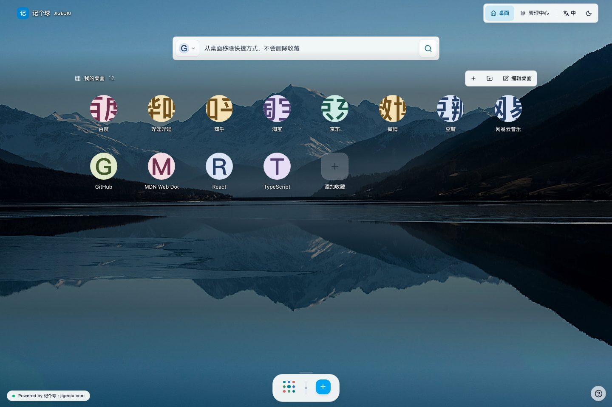
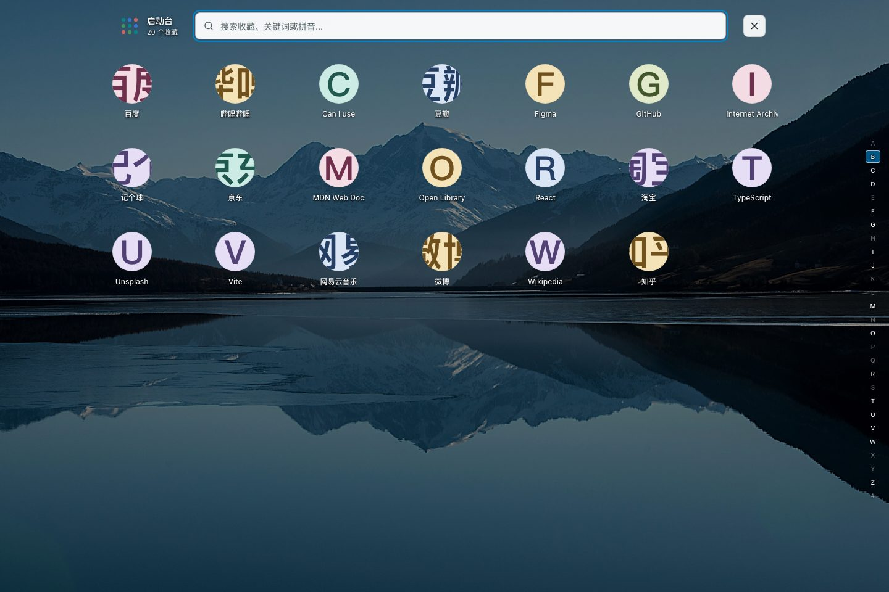
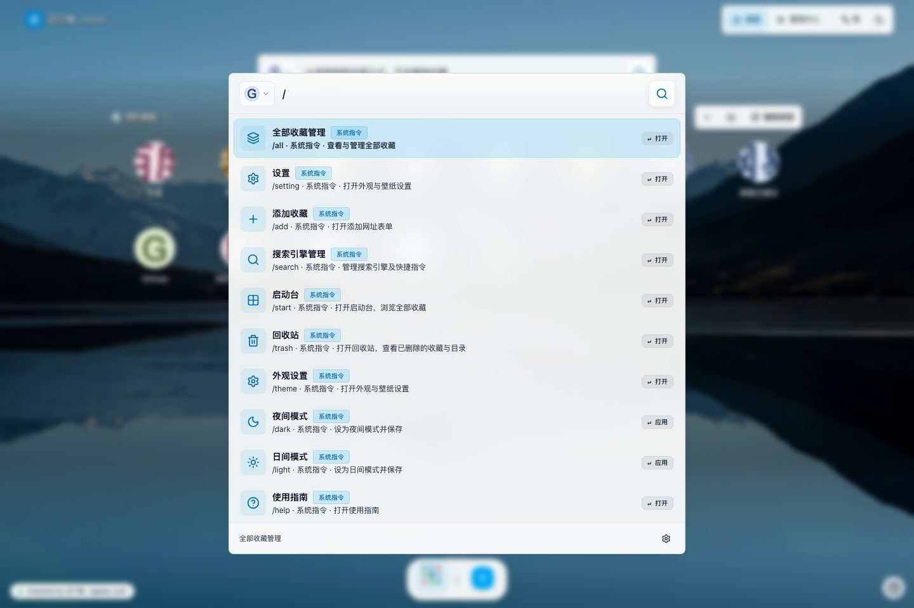
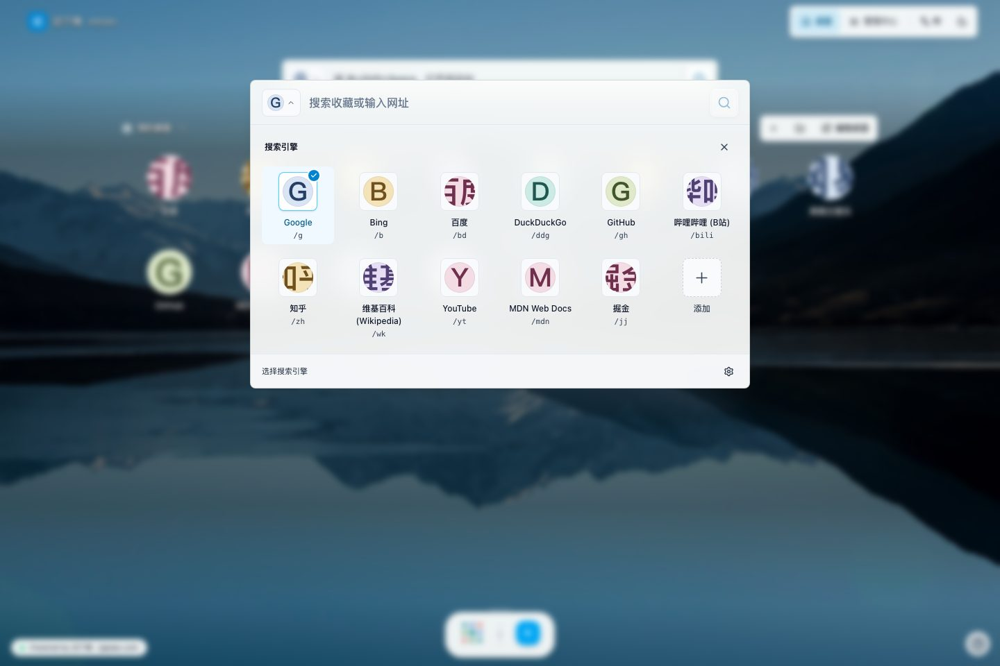
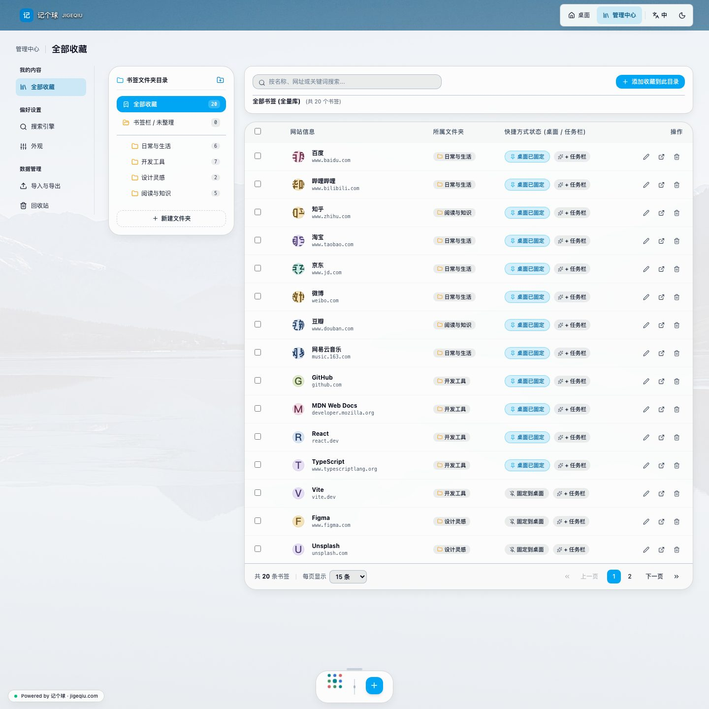
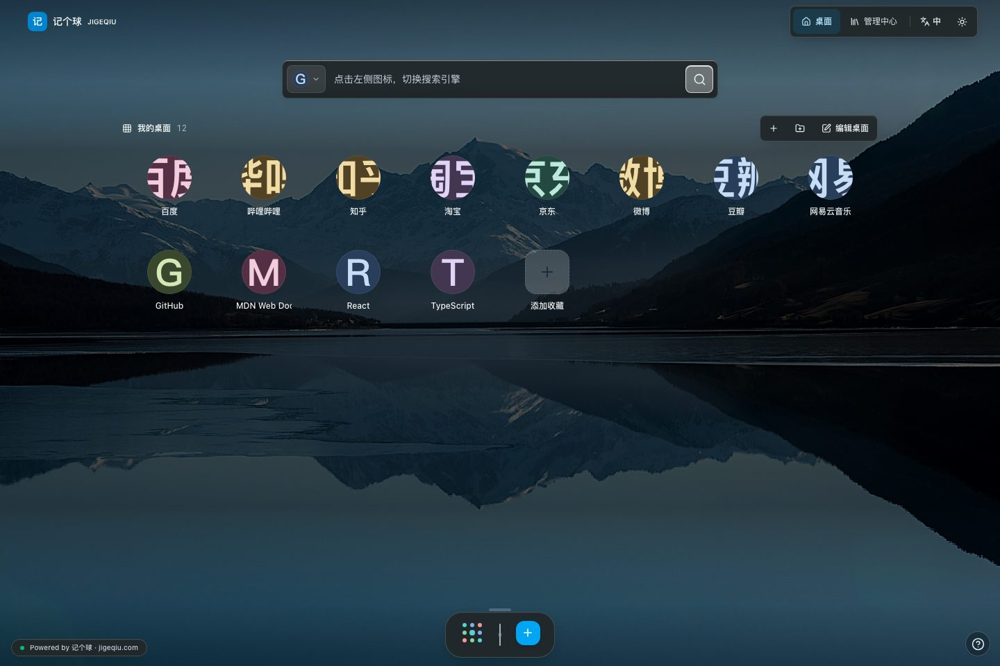

# JIGEQIU 记个球

**Turn your bookmarks into a personal workspace.**

JIGEQIU is a self-hostable bookmark manager that runs locally with a single command. Bring everyday browsing
together with desktop shortcuts, a launchpad, global search, and nested folders.
No account, application backend, database, or API key required. You can also
build it as a static website.

[简体中文](README.md) | **English**

[Live Demo](https://jiawulin.github.io/) · [Quick Start](#quick-start) ·
[Usage](#usage) · [Self-Hosting](#self-hosting) · [MIT License](LICENSE)



## Features

| Capability | Details |
| --- | --- |
| Bookmark management | Nested folders, keywords, search, bulk moves, and a recycle bin |
| Desktop workspace | Independent shortcuts, desktop folders, pages, and taskbar pins |
| Launchpad | Browse all bookmarks with pinyin search and keyboard navigation |
| Global search | Find bookmarks, switch search engines, and run quick commands |
| Import and backup | Browser bookmark HTML import, standard HTML export, and JSON asset backups |
| Personalization | Light and dark themes, glass surfaces, built-in and custom local wallpapers |
| Bilingual interface | Switch between Simplified Chinese and English |
| Static deployment | No application backend, database, or API key required in production |

## Screenshots

### App Drawer

Browse your entire library in the launchpad and find websites by title, keywords,
or pinyin.



### Search and Commands

Type `/` in global search to list quick commands and search engine shortcuts.



### Custom Search Engines

Click the engine icon on the left of the desktop search bar to open the picker.
Switch between general search, knowledge communities, video sites, and developer
tools. Use the add button to choose from the built-in catalog or define your own
engine name, command, and search URL.



### Bookmark Library

Organize websites into folders and search, edit, or move bookmarks in one workspace.



### Dark Desktop

Switch appearance while keeping the same bookmarks and desktop layout.



Screenshots use demonstration bookmarks, not personal browser data.

## Try It Online

Visit the **[demo entry page](https://jiawulin.github.io/)** and select JIGEQIU to open the demo.
The existing **[jigeqiu.com](https://jigeqiu.com/)** site remains available.

Both the demo and self-hosted deployments keep bookmarks in each visitor's
browser. Different domains, ports, and browser profiles have separate data.
Use export and import to move your bookmarks between them.

## Quick Start

### Option 1: Run From Source

Requirements: Node.js 20.19.2, npm 10.8.2, and a modern browser with Web Locks support.

Clone this repository, or download and extract the source ZIP:

```sh
git clone https://github.com/jiawulin/jigeqiu.git
```

Enter the project folder, install dependencies, and start the app:

```sh
cd jigeqiu
npm install
npm run dev
```

For a ZIP download, replace the `cd` path with the extracted source folder.

Visit **[http://127.0.0.1:3000](http://127.0.0.1:3000)** in your browser.
No application backend or database is required; keep the server process running.

#### Optional Settings

Copy `.env.example` to `.env` to change the bind address (`HOST`) or port (`PORT`), or set `DISABLE_HMR=true`
to disable development hot reload and file watching. Shell variables take precedence.
No `.env` file is needed for the defaults; use the matching address if you change the port.
The server listens on `127.0.0.1` by default. For LAN access, set `HOST=0.0.0.0`,
use a trusted network, and access the site over HTTPS.

### Option 2: Deploy the Static Package

No Node.js installation or local build is required.

1. Download `jigeqiu-v0.1.0-web.zip` from [Releases](https://github.com/jiawulin/jigeqiu/releases), using the matching version for later releases.
2. Extract the ZIP contents into your Nginx web root. The root should directly contain `index.html`, `assets/`, and `wallpapers/`.
3. Configure the site, reload Nginx, and open its address in your browser.

Example for a local Nginx site (adjust `root` to your deployment path):

```nginx
server {
    listen 127.0.0.1:8080;
    server_name localhost;
    root /var/www/jigeqiu;
    index index.html;

    location / {
        try_files $uri $uri/ =404;
    }
}
```

Validate and reload the configuration, then open **[http://127.0.0.1:8080](http://127.0.0.1:8080)**:

```sh
nginx -t
nginx -s reload
```

HTTP is supported on localhost; configure HTTPS when using a LAN IP or public domain.
Use the `SHA256SUMS.txt` release attachment to verify the ZIP.
The app uses hash routing, so no additional SPA route rewrites are required.

## Usage

### Import Your Bookmarks

1. Export your browser bookmarks as an HTML file from its bookmark manager.
2. In JIGEQIU, open **Manage → Import & Export → Chrome Bookmark Import**.
3. Select the file, review the import preview, and confirm.
4. Open **All Bookmarks** to browse and organize the imported folders and websites.

The importer primarily targets Chrome bookmark HTML. For files exported by other
browsers, review the preview before confirming. Previewing or canceling does not
write to your library, and importing does not automatically populate your desktop.

### Set Up Your Desktop

- Add bookmarks from the desktop, or pin existing bookmarks from the library or launchpad.
- Use library folders to organize assets and desktop folders to group shortcuts independently.
- Pin frequently used bookmarks to the taskbar, or access your entire library through the launchpad.
- Open **Manage → Appearance** to switch themes, select a wallpaper, or upload a local background.

Removing a desktop shortcut or unpinning a taskbar item does not delete the
bookmark. Deleted bookmarks go to the recycle bin; pin them again after restoring
if you want them back on your desktop.

### Search and Commands

Use global search to find bookmarks by title, domain, or keywords, or send your
query to the selected search engine. The launchpad also supports pinyin search.
Add engines from the built-in catalog or configure your own.
Type `/` in the search box to see the available commands.

| Command | Action |
| --- | --- |
| `/all` | Open all bookmarks |
| `/start` | Open the launchpad |
| `/add` | Add a bookmark |
| `/search` | Manage search engines |
| `/theme` | Open appearance settings |
| `/dark`, `/light` | Enable dark or light mode |
| `/trash` | Open the recycle bin |
| `/help` | Open the user guide |

The guide in the bottom-right corner provides keyboard shortcuts, search commands,
and instructions.

### Back Up and Migrate

Open **Manage → Import & Export**:

- **HTML export** exchanges website addresses and folders with browsers.
- **JSON asset backup** backs up and transfers JIGEQIU bookmark assets, with a preview before import.

JSON backups include active bookmarks, library folders, and legacy collection
compatibility data. They exclude settings, search engines, desktop and taskbar
layouts, the recycle bin, icon caches, and custom wallpapers.
Keep regular backups outside your browser, especially before clearing site data
or changing your deployment address.

## Self-Hosting

### Build

```sh
npm ci
npm run build
```

### Publish Static Files

Upload the **entire contents of `dist/`** to the root of an HTTPS website:

```text
site-root/
├── index.html
├── favicon.ico
├── assets/
└── wallpapers/
```

Use Nginx, Caddy, or an HTTPS-enabled static hosting provider.
Production serves static files only; no Express process, Node.js runtime,
or database server is needed.

Preview the production build locally:

```sh
npm run preview
```

Deployment requirements:

- Use HTTPS for public domains and LAN IPs; HTTP is supported on `localhost` and `127.0.0.1`. Protected writes require a secure context, Web Locks, and available browser storage.
- Default builds deploy at the site root; keep all asset directories. Opening files directly with `file://` is not supported.
- Pages use hash routes such as `/#/library`; application-level route rewrites are unnecessary.
- Use the development server for local development and a static file server for production.

### GitHub Pages and Subpaths

`.github/workflows/pages.yml` publishes the demo. Pull requests only run checks;
pushes to `master` and manual runs deploy `dist/` after checks pass.
No personal Token Secret is needed. In Settings → Pages select GitHub Actions
as the source, and allow `master` in the `github-pages` environment.

For another subpath deployment, build with your actual address:

```sh
VITE_SITE_URL=https://example.com/jigeqiu/ npm run build -- --base=/jigeqiu/
```

`--base` sets the local asset prefix; `VITE_SITE_URL` sets canonical and sharing URLs.
Default builds and Release ZIPs continue to support root deployment.
To roll back, revert the relevant commit and push `master` to redeploy.

## Data and Privacy

Bookmarks and preferences use browser LocalStorage. Icon caches and custom
wallpapers use IndexedDB. The server distributes the application files,
not your bookmark library.

On insecure HTTP origins, onboarding alone falls back to a lightweight cookie
lasting up to 400 days. It remembers welcome exposure, not bookmarks or full task
progress, and is sent with requests to the same host. Browser policies or clearing
data may remove it sooner. Related notices dismiss after about six seconds,
pause while hovered or focused, and do not repeat within the current page session.
This fallback does not bypass HTTPS/Web Locks requirements for protected writes.

Clearing site data, deleting a browser profile, or ending a private browsing
session can remove local data. Storage capacity depends on the browser and
device. The recycle bin is not a substitute for an independent backup.

Online fonts, website icons, and external websites you open can generate network
requests. Use trusted builds and a dedicated site origin. Never include private
URLs, personal bookmark backups, cookies, or credentials in public issues.

## Development and Contributions

Built with React, TypeScript, Vite, Tailwind CSS, Lucide, and Motion.
HTML parsing uses parse5; pinyin indexing uses pinyin-pro.

| Command | Purpose |
| --- | --- |
| `npm run dev` | Start the development server |
| `npm run build` | Build static assets |
| `npm run preview` | Preview the production build |
| `npm test` | Run unit tests |
| `npm run typecheck` | Check TypeScript types |
| `npm run lint` | Lint JavaScript tooling and test runners |
| `npm run check` | Run tests, contract checks, lint, types, scoped formatting, and the build |

Browser regression tests require a separate Playwright and Chromium installation:

```sh
PLAYWRIGHT_MODULE=/absolute/path/to/playwright/index.mjs npm run test:browser:static-first-use
```

Issues and pull requests are welcome. Include reproduction steps, browser details,
and expected behavior in bug reports. Keep changes focused, add tests for behavior
changes, and run `npm run check` before submitting.
Use synthetic fixtures and isolated browser contexts for testing.

## License

The source code is available under the [MIT License](LICENSE), allowing use,
modification, and redistribution with the required copyright and permission notices.

Third-party dependencies and assets retain their own licenses.
See the [background credits](public/wallpapers/CREDITS.md) for built-in image sources.
