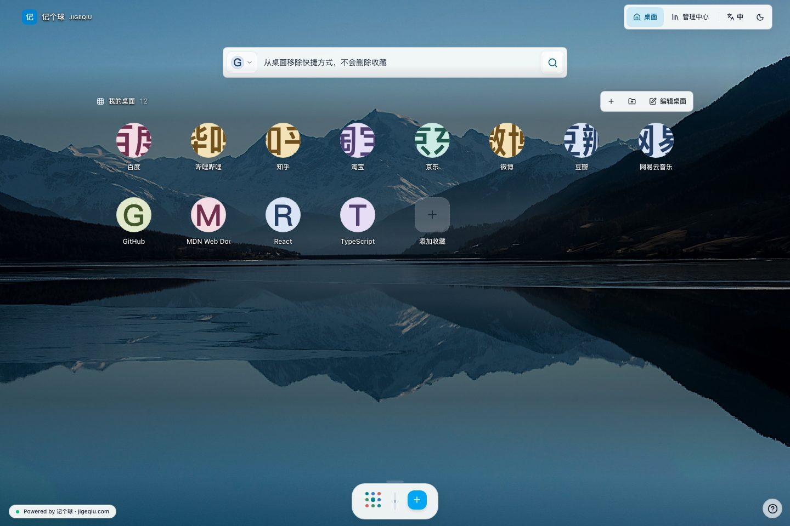
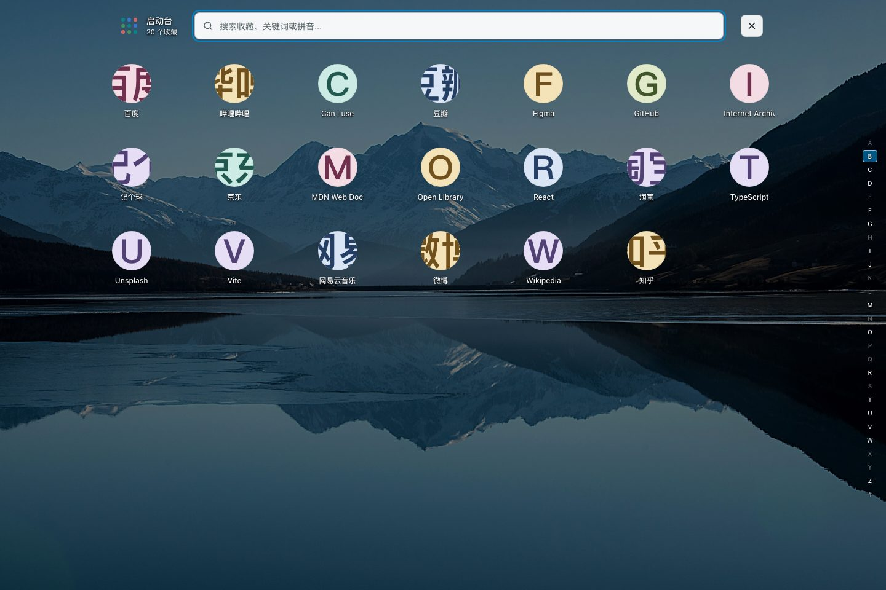
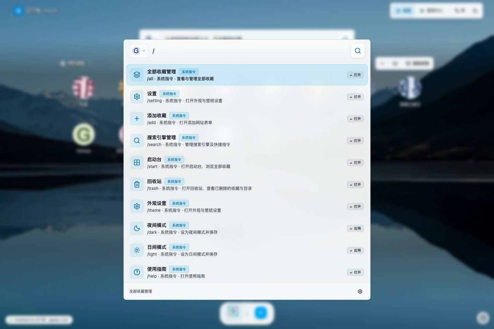
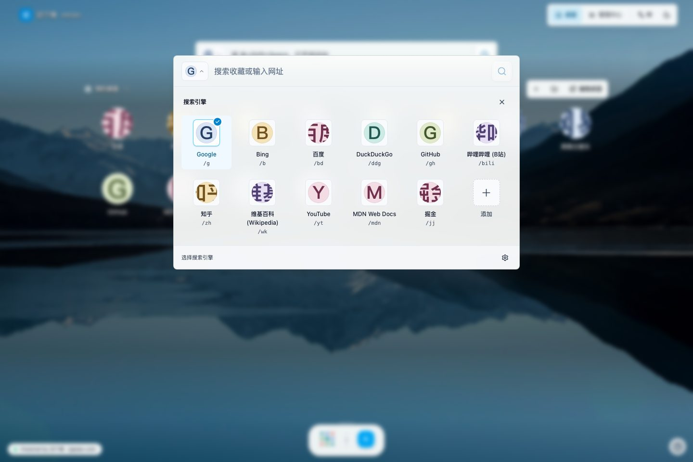
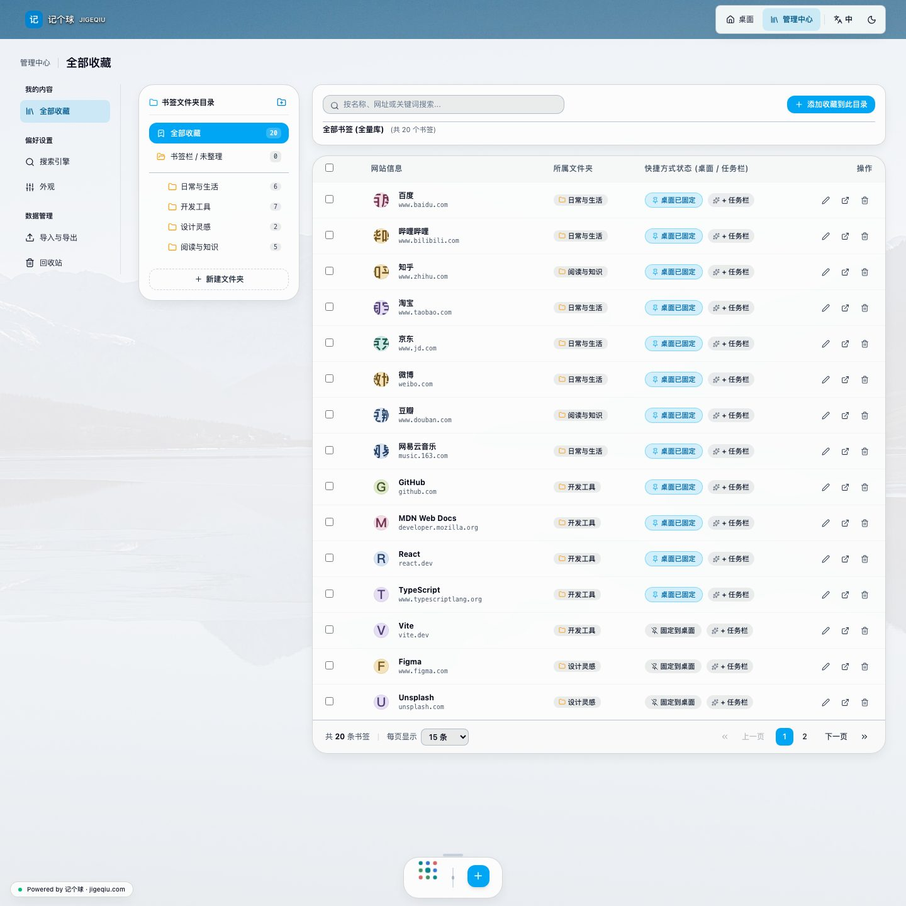
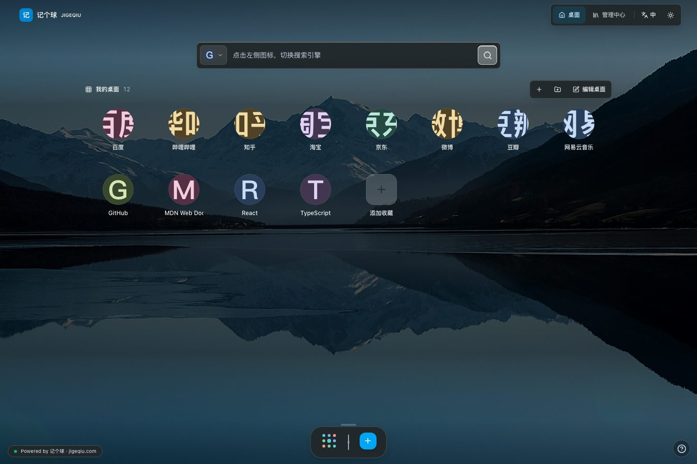

# 记个球 JIGEQIU

**把收藏整理成你的个人工作台。**

记个球是一款可本机部署、一条命令即可启动的网址收藏管理工具。以桌面快捷方式、
启动台和全局搜索连接日常浏览，用多层目录整理收藏，让常用网站随手可达。
无需注册账号，无需业务后端、数据库或 API Key，也可构建为静态站点部署。

**简体中文** | [English](README.en.md)

[在线演示](https://jigeqiu.com/) · [快速开始](#快速开始) ·
[使用指南](#使用指南) · [自行部署](#自行部署) · [MIT License](LICENSE)



## 项目特色

| 能力 | 说明 |
| --- | --- |
| 收藏管理 | 多层目录、关键词、搜索、批量移动与回收站 |
| 桌面工作台 | 独立快捷方式、桌面文件夹、分页与任务栏固定 |
| 全量启动台 | 集中浏览全部收藏，支持拼音检索和键盘导航 |
| 全局搜索 | 搜索收藏、切换搜索引擎，使用快捷指令直达功能 |
| 导入与备份 | 浏览器书签 HTML 导入、标准 HTML 导出、JSON 资产备份 |
| 个性化外观 | 明暗主题、玻璃材质、内置壁纸与本地自定义背景 |
| 中英双语 | 界面内切换简体中文与英文 |
| 静态部署 | 构建后只需静态文件服务，无需业务后端、数据库或 API Key |

## 界面预览

### 应用抽屉

在启动台集中浏览全部收藏，通过标题、关键词或拼音快速找到网站。



### 搜索与指令

在全局搜索框输入 `/`，列出快捷指令与搜索引擎入口。



### 自定义搜索引擎

点击桌面搜索框左侧的引擎图标，展开搜索引擎选择面板。
可在通用搜索、知识社区、视频和开发工具之间切换，也可通过“添加”入口
从内置候选库添加引擎，或自定义名称、快捷指令与搜索网址。



### 收藏库

用目录组织网址，在同一工作区完成搜索、编辑与批量整理。



### 夜间桌面

按使用习惯切换外观，保留同一套收藏与桌面布局。



以上截图使用演示收藏，不包含个人浏览器数据。

## 在线体验

访问 **[jigeqiu.com](https://jigeqiu.com/)**，直接在浏览器中使用。

演示站与自行部署的站点都将收藏保存在访问者自己的浏览器中。
不同域名、端口或浏览器配置拥有独立数据；迁移时使用导出和导入功能。

## 快速开始

### 方式一：源码运行

环境要求：Node.js 20.19.2、npm 10.8.2，以及支持 Web Locks 的现代浏览器。

克隆本仓库，或下载源码 ZIP 并解压：

```sh
git clone https://github.com/jiawulin/jigeqiu.git
```

进入项目目录，安装依赖并启动：

```sh
cd jigeqiu
npm install
npm run dev
```

下载 ZIP 时，将 `cd` 路径替换为解压后的源码目录。

浏览器打开 **http://127.0.0.1:3000**。
无需业务后端或数据库，保持启动进程运行即可。

#### 可选配置

将 `.env.example` 复制为 `.env`，可通过 `PORT` 修改端口，
或设置 `DISABLE_HMR=true` 关闭开发热更新与文件监听；系统环境变量优先。
默认配置无需创建 `.env`，修改端口后请访问对应地址。
开发服务监听所有网卡，请仅在可信网络中使用。

### 方式二：下载静态包部署

无需安装 Node.js，也无需自行编译。

1. 从 [Releases](https://github.com/jiawulin/jigeqiu/releases) 下载 `jigeqiu-v0.1.0-web.zip`（后续版本使用对应版本号）。
2. 将 ZIP 内的文件解压到 Nginx 站点根目录，确保根目录直接包含 `index.html`、`assets/` 和 `wallpapers/`。
3. 配置站点并重载 Nginx，在浏览器访问站点地址。

本机 Nginx 配置示例（按实际路径修改 `root`）：

```nginx
server {
    listen 127.0.0.1:8080;
    server_name localhost;
    root /var/www/jigeqiu;
    index index.html;

    location / {
        try_files $uri $uri/ =404;
    }
}
```

检查配置并重载后，打开 **http://127.0.0.1:8080**：

```sh
nginx -t
nginx -s reload
```

本机访问可使用 HTTP；通过局域网 IP 或正式域名访问时，请配置 HTTPS。
可用发布附件 `SHA256SUMS.txt` 校验下载包。项目使用 Hash 路由，无需额外的 SPA 路由重写。

## 使用指南

### 导入已有书签

1. 在浏览器书签管理器中将书签导出为 HTML 文件。
2. 打开记个球，进入 **管理中心 → 导入与导出 → Chrome 书签导入**。
3. 选择文件，检查导入预览并确认。
4. 在 **全部收藏** 中查看目录与网址，按需整理。

导入入口以 Chrome 书签 HTML 格式为主；其他浏览器导出文件请先检查预览结果。
预览和取消操作不会写入收藏库，导入也不会自动铺满桌面。

### 构建个人桌面

- 在桌面添加收藏，或从收藏库、启动台将已有收藏固定到桌面。
- 用收藏库目录管理资产，用桌面文件夹组织快捷方式，两者互不影响。
- 将常用收藏固定到任务栏，或通过启动台访问全部收藏。
- 在 **管理中心 → 外观** 中切换主题、选择壁纸或上传本地背景图片。

从桌面移除快捷方式、取消任务栏固定不会删除原收藏。
删除收藏会进入回收站；恢复后可按需重新固定。

### 搜索与快捷指令

全局搜索支持标题、域名和关键词，也可将输入交给选定的搜索引擎。
启动台另提供拼音检索。搜索引擎可以从内置候选库添加，或配置自定义引擎。
在搜索框输入 `/` 即可查看可用指令列表。

| 指令 | 操作 |
| --- | --- |
| `/all` | 打开全部收藏 |
| `/start` | 打开启动台 |
| `/add` | 添加收藏 |
| `/search` | 管理搜索引擎 |
| `/theme` | 打开外观设置 |
| `/dark`、`/light` | 切换夜间、日间模式 |
| `/trash` | 打开回收站 |
| `/help` | 打开使用指南 |

桌面右下角的使用指南提供快捷键、搜索指令和操作说明。

### 备份与迁移

在 **管理中心 → 导入与导出** 中：

- **HTML 导出**：用于与浏览器交换网址和目录。
- **JSON 资产备份**：用于记个球收藏资产的备份与迁移，导入前提供预览。

JSON 备份包含有效收藏、收藏库目录及历史网址单兼容数据，
不包含设置、搜索引擎、桌面与任务栏布局、回收站、图标缓存或自定义壁纸。
请定期将备份保存在浏览器之外，尤其是在清除站点数据或更换部署地址之前。

## 自行部署

### 构建

```sh
npm ci
npm run build
```

### 发布静态文件

将 **完整 `dist/` 目录内的文件**上传到 HTTPS 站点根目录：

```text
站点根目录/
├── index.html
├── favicon.ico
├── assets/
└── wallpapers/
```

可使用 Nginx、Caddy 或支持 HTTPS 的静态托管平台。
生产环境只分发静态资源，不需要运行 Express、Node.js 或数据库服务。

本地预览构建产物：

```sh
npm run preview
```

部署要求：

- 正式域名及局域网 IP 使用 HTTPS；本机 `localhost`、`127.0.0.1` 可使用 HTTP。受保护写入需要安全上下文、Web Locks 和可用的浏览器存储。
- 部署到站点根路径，保留完整资源目录。直接打开 `file://` 文件不是运行方式。
- 页面使用 Hash 路由，例如 `/#/library`，无需应用层路由重写。
- 开发服务器用于本机开发，生产环境使用静态文件服务器。

## 数据与隐私

收藏与偏好存储在浏览器 LocalStorage 中，图标缓存及自定义壁纸存储在 IndexedDB 中。
服务器负责分发应用文件，不托管你的收藏库。

清除站点数据、删除浏览器配置或结束隐私会话可能导致本机数据丢失。
浏览器存储容量受浏览器和设备限制；回收站不能替代独立备份。

在线字体、网站图标及主动打开的外部网站会产生网络请求。
请使用可信构建和独立站点来源，不要在公开 issue 中附带私人网址、
真实书签备份、Cookie 或密钥。

## 开发与贡献

项目使用 React、TypeScript、Vite、Tailwind CSS、Lucide 和 Motion；
HTML 解析使用 parse5，拼音索引使用 pinyin-pro。

| 命令 | 用途 |
| --- | --- |
| `npm run dev` | 启动开发服务 |
| `npm run build` | 构建静态资源 |
| `npm run preview` | 预览构建结果 |
| `npm test` | 运行单元测试 |
| `npm run typecheck` | TypeScript 类型检查 |
| `npm run lint` | JavaScript 工具与测试脚本检查 |
| `npm run check` | 执行测试、契约、lint、类型、受控格式检查与构建 |

浏览器回归使用 Playwright 与 Chromium，需单独提供运行环境：

```sh
PLAYWRIGHT_MODULE=/absolute/path/to/playwright/index.mjs npm run test:browser:static-first-use
```

欢迎提交问题报告和 Pull Request。请描述复现步骤、浏览器环境及预期行为；
代码修改保持范围清晰，为行为变化补充测试，并在提交前运行 `npm run check`。
测试请使用合成数据和独立浏览器上下文。

## 许可证

项目源码采用 [MIT License](LICENSE)，允许使用、修改和再分发，
并保留许可证要求的版权及许可声明。

第三方依赖和素材遵循各自许可证，内置背景的来源见
[素材声明](public/wallpapers/CREDITS.md)。
